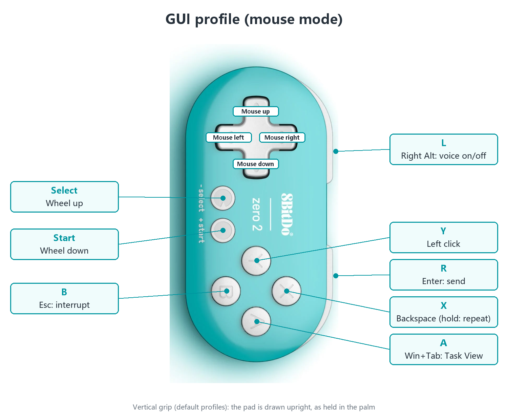
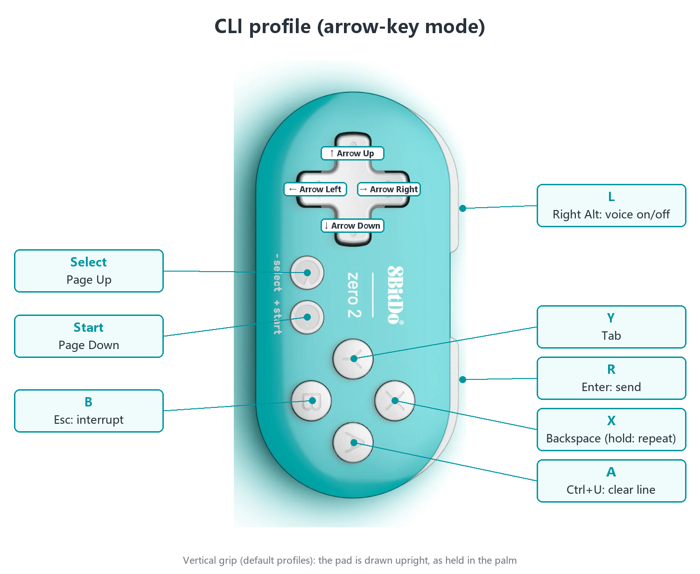

# 8BitDo Zero 2 × AntiMicroX: Voice Input + AI Coding Gamepad Mapping

[中文](README.zh-CN.md) | **English**

Use an 8BitDo Zero 2 gamepad instead of a keyboard, together with [Typeless](https://www.typeless.com/) voice input, to work hands-off the keyboard in VS Code, Claude Code, Codex and similar tools. Everything runs on free, open-source software ([AntiMicroX](https://github.com/AntiMicroX/antimicrox)).

Two profiles are provided:

- **GUI profile**: for graphical apps only, e.g. the VS Code editor and the Claude Code / Codex desktop clients (D-pad moves the mouse).
- **CLI profile**: for terminals only, including the Claude Code / Codex CLI and the VS Code integrated terminal (D-pad sends arrow keys).

**L / R / B / X are identical** in both profiles.

## Requirements

| Item | Details |
|---|---|
| Gamepad | 8BitDo Zero 2 in **X-input mode** |
| Software | AntiMicroX 3.x (Windows) |
| Voice input | Typeless (`Right Alt`: tap once to start, tap again to stop) |

The default voice input app is **Typeless**, and the L button sends `Right Alt`. If you use a different voice input app, you can either:

- change that app's voice hotkey to `Right Alt`, or
- change the key assigned to the L button in AntiMicroX and save it as your own profile.

## Grip: vertical by default

The default files are made for the **vertical grip**: the Zero 2 is held upright in the palm, and "up / down / left / right" on the D-pad are meant as seen in that orientation. The diagrams and tables below use the same orientation. (On the device itself the directions are rotated by 90°: the pad's left = vertical up, right = down, down = left, up = right.)

If you hold the pad **horizontally**, use the `-horizontal` files instead; the D-pad then behaves normally.

| Grip | GUI | CLI |
|---|---|---|
| Vertical (default) | `Zero2-GUI.gamecontroller.amgp` | `Zero2-CLI.gamecontroller.amgp` |
| Horizontal | `Zero2-GUI-horizontal.gamecontroller.amgp` | `Zero2-CLI-horizontal.gamecontroller.amgp` |

> In X-input mode the Zero 2 reports its D-pad as the **left stick**, so the profiles bind Stick 1, not the DPad.

## Shared buttons

| Button | Action |
|---|---|
| L | `Right Alt`: start / stop voice input |
| R | `Enter`: send |
| B | `Esc`: interrupt |
| X | `Backspace`, hold to repeat (100 ms interval) |

## GUI profile

File: [profiles/antimicrox/Zero2-GUI.gamecontroller.amgp](profiles/antimicrox/Zero2-GUI.gamecontroller.amgp)

| Button | Action |
|---|---|
| D-pad up | Mouse up |
| D-pad down | Mouse down |
| D-pad left | Mouse left |
| D-pad right | Mouse right |
| Select | Mouse wheel up (repeats) |
| Start | Mouse wheel down (repeats) |
| Y | Left mouse click |
| A | `Win + Tab`: Task View |

## CLI profile

File: [profiles/antimicrox/Zero2-CLI.gamecontroller.amgp](profiles/antimicrox/Zero2-CLI.gamecontroller.amgp)

| Button | Action |
|---|---|
| D-pad up | Arrow Up ↑ |
| D-pad down | Arrow Down ↓ |
| D-pad left | Arrow Left ← |
| D-pad right | Arrow Right → |
| Select | `Page Up` |
| Start | `Page Down` |
| Y | `Tab` |
| A | `Ctrl + U`: clear the current input line |

All four arrow keys repeat while held (80 ms interval).

## How to use

1. Install [AntiMicroX](https://github.com/AntiMicroX/antimicrox/releases/latest) (on Windows download `Windows-AMD64.exe`).
2. Switch the gamepad to X-input mode, connect it, and check that AntiMicroX shows it in the main window.
3. Click **Load** and pick the GUI or CLI `.amgp` file.
4. To switch between GUI and CLI, load the other file.

## Known limitations

- **No long-press actions.** AntiMicroX's `hold` slot sends the preceding key immediately on press, so a button cannot be "tap = A, long-press = B" exclusively. Typeless translate (`Right Alt + Right Shift`) and ask-anything (`Right Alt + Space`) are therefore not mapped to the gamepad.
- **AntiMicroX cannot tell a terminal from a graphical app.** The VS Code editor vs. its integrated terminal, and the Claude Code / Codex clients vs. their CLI, look the same to it, so profiles cannot switch automatically per window; load the matching file by hand.
- Button numbers follow the SDL gamepad layout. If a button does not match its label, adjust it in AntiMicroX and save a new profile.
- The horizontal-grip files were generated from the same script and have not been tested on a device.
- AntiMicroX itself is only lightly maintained at the moment; see its [README](https://github.com/AntiMicroX/antimicrox).

## License

MIT (AntiMicroX itself is GPL v3)
