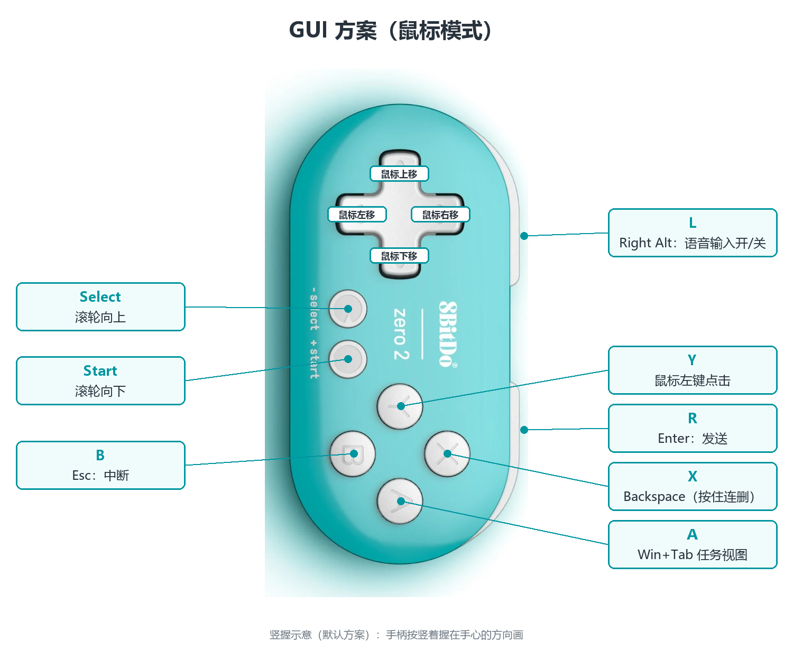

# 8BitDo Zero 2 × AntiMicroX：语音输入 + AI 编程手柄映射

**中文** | [English](README.md)

用 8BitDo Zero 2 手柄代替键盘，配合 [Typeless](https://www.typeless.com/) 语音输入，在 VS Code / Claude Code / Codex 等场景下免键盘工作。全部使用免费开源软件（[AntiMicroX](https://github.com/AntiMicroX/antimicrox)）。

提供两套方案：

- **GUI 方案**：只在图形界面里用，比如 VS Code 编辑器、Claude Code / Codex 客户端（十字键控制鼠标）
- **CLI 方案**：只在终端 / 命令行里用，包括 Claude Code / Codex 的 CLI，以及 VS Code 内置终端（十字键变方向键）

两套方案中 **L / R / B / X 完全一致**。

## 环境

| 项目 | 说明 |
|---|---|
| 手柄 | 8BitDo Zero 2，**X-input 模式** |
| 软件 | AntiMicroX 3.x（Windows） |
| 语音输入 | Typeless（`Right Alt` 点一下开始，再点一下结束） |

默认的语音输入软件是 **Typeless**，L 键发送的是 `Right Alt`。如果你用的是其他语音输入软件，有两种办法：

- 把那个软件的语音快捷键改成 `Right Alt`；
- 或者在 AntiMicroX 里改 L 键的按键，再另存为自己的方案文件。

## 握法：默认竖握

默认文件按**竖握**做：把 Zero 2 竖着握在手心，十字键的「上、下、左、右」都按**竖着拿的方向**算，下面的示意图和键位表也都按这个方向写。（手柄本身的方向是转了 90° 的：手柄的左 = 竖握的上，右 = 下，下 = 左，上 = 右。）

如果你是**横着握**，请改用带 `-horizontal` 的文件，十字键就是正常的上下左右：

| 握法 | GUI | CLI |
|---|---|---|
| 竖握（默认） | `Zero2-GUI.gamecontroller.amgp` | `Zero2-CLI.gamecontroller.amgp` |
| 横握 | `Zero2-GUI-horizontal.gamecontroller.amgp` | `Zero2-CLI-horizontal.gamecontroller.amgp` |

> Zero 2 在 X-input 模式下，十字键是作为**左摇杆**上报的，所以方案里绑定的是 Stick 1，而不是 DPad。

## 通用键位

| 键 | 效果 |
|---|---|
| L | `Right Alt`：开始 / 结束语音输入 |
| R | `Enter`：发送 |
| B | `Esc`：中断 |
| X | `Backspace`，按住连删（间隔 100 ms） |

## GUI 方案

文件：[profiles/antimicrox/Zero2-GUI.gamecontroller.amgp](profiles/antimicrox/Zero2-GUI.gamecontroller.amgp)

| 键 | 效果 |
|---|---|
| 十字键（上） | 鼠标上移 |
| 十字键（下） | 鼠标下移 |
| 十字键（左） | 鼠标左移 |
| 十字键（右） | 鼠标右移 |
| Select | 鼠标滚轮向上（连发） |
| Start | 鼠标滚轮向下（连发） |
| Y | 鼠标左键点击 |
| A | `Win + Tab`：任务视图 |

## CLI 方案

文件：[profiles/antimicrox/Zero2-CLI.gamecontroller.amgp](profiles/antimicrox/Zero2-CLI.gamecontroller.amgp)

| 键 | 效果 |
|---|---|
| 十字键（上） | 方向键上 ↑ |
| 十字键（下） | 方向键下 ↓ |
| 十字键（左） | 方向键左 ← |
| 十字键（右） | 方向键右 → |

四个方向键都是按住连发，间隔 80 ms。
| Select | `Page Up` |
| Start | `Page Down` |
| Y | `Tab` |
| A | `Ctrl + U`：清空当前输入行 |

## 使用方法

1. 安装 [AntiMicroX](https://github.com/AntiMicroX/antimicrox/releases/latest)（Windows 下载 `Windows-AMD64.exe`）。
2. 手柄切到 X-input 模式并连接，确认 AntiMicroX 主窗口能看到它。
3. 点 **Load**，选择 GUI 或 CLI 的 `.amgp` 文件。
4. 在 GUI / CLI 之间切换：重新 Load 另一个文件。

## 已知限制

- 不支持长按。AntiMicroX 的 `hold` 在按下时就先发出前面的键，无法做到「轻点发送 / 长按另做他用」二选一，因此 Typeless 的翻译（`Right Alt + Right Shift`）和问任何问题（`Right Alt + Space`）没有放进手柄。
- AntiMicroX 无法区分终端和图形界面：VS Code 里的编辑器与内置终端、Claude Code / Codex 的客户端与 CLI，对它来说都是同一个窗口或同类窗口，所以不能按窗口自动切换两套方案，需要你手动 Load 对应的文件。
- 键位按 SDL 手柄编号写成，若按键与标注不一致，可在 AntiMicroX 里手动调整后另存。
- 横握版文件由同一个脚本转换方向生成，尚未在真机上测试。
- AntiMicroX 目前维护有限，详见其[说明](https://github.com/AntiMicroX/antimicrox)。

## 许可

MIT（AntiMicroX 本身为 GPL v3）
